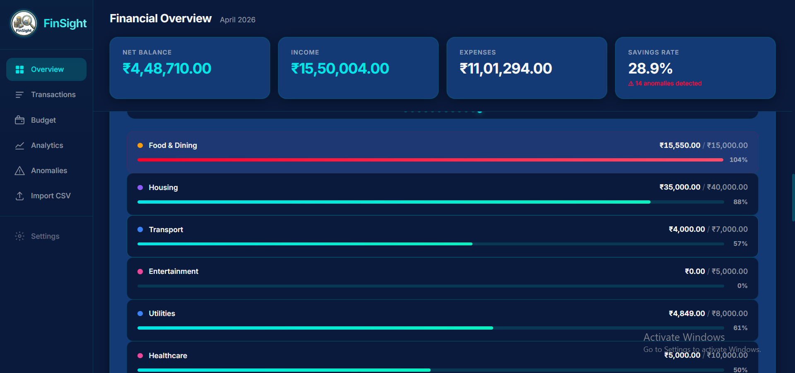
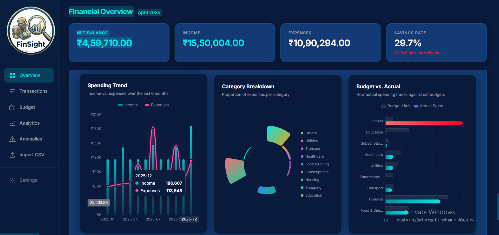

# FinSight Analytics

### Making Financial Data Meaningful

## Project Overview
FinSight Analytics is a personal finance management and data visualization system that helps users track income and expenses, analyze spending patterns, and understand their financial habits through interactive dashboards.

## Tech Stack
- **Frontend:** HTML, CSS, JavaScript
- **Backend:** Node.js, Express.js
- **Database:** PostgreSQL (Supabase)
- **Visualization:** Chart.js
- **Tools:** VS Code, Git, GitHub

## System Architecture
## System Architecture

```text
FinSight/
│
├── config/
│   └── db.js
│
├── middleware/
│   └── apiKey.js
│
├── routes/
│   └── transactions.js
│
├── public/
│   ├── styles.css
│   └── logo.png
│
├── data/
│   ├── test_data_2025.csv
│   └── test_data_2026.csv
│
├── database/
│   └── schema.sql
│
├── index.html
├── app.js
├── server.js
├── .gitignore
├── package.json
├── package-lock.json
└── README.md
```

## Key Features
1. Transaction Management
- Add financial transactions.
- View transaction records.
- Manage income and expenses.
- Store transaction data in a database.
2. CSV Upload
- Import financial transactions through CSV files.
- Process and organize transaction data.
- Clean and validate uploaded data.
3. Expense Categorization
- Categorize transactions based on descriptions and keywords.
- Group expenses into categories such as Food, Travel, Shopping, Bills, and Healthcare.
4. Financial Analytics
- Calculate total income and expenses.
- Analyze category-wise spending.
- Calculate average daily expenses.
- Compare monthly spending patterns.
5. Data Visualization
- Category-wise expense distribution.
- Monthly spending analysis.
- Interactive financial charts.
6. Statistical Analysis
- Calculate mean and median.
- Measure standard deviation.
- Identify unusual transactions using Z-score-based anomaly detection.

## Project Screenshots
- Dashboard

- Data Visualizations


## Setup Instructions

1. Clone the repository:

   ```bash
   git clone https://github.com/dhanakshi04-gito/FinSight.git
   ```

2. Navigate to the project folder:

   ```bash
   cd FinSight
   ```

3. Install dependencies:

   ```bash
   npm install
   ```

4. Create a `.env` file and configure your database:

   ```env
   DATABASE_URL=your_supabase_connection_string
   ```

5. Execute the SQL commands in `database/schema.sql` in your Supabase SQL Editor.

6. Start the backend:

   ```bash
   node server.js
   ```

7. Open the frontend using VS Code Live Server.

## Future Enhancements
- Monthly budget tracking.
- Recurring expense detection.
- AI-powered financial recommendations.
- Unusual spending detection.
- Downloadable financial reports.
- User authentication.

## Team Project
Developed as a collaborative project to explore full-stack development, database management, financial analytics, and data visualization.

---

**FinSight Analytics – Turning Transactions into Insights.**